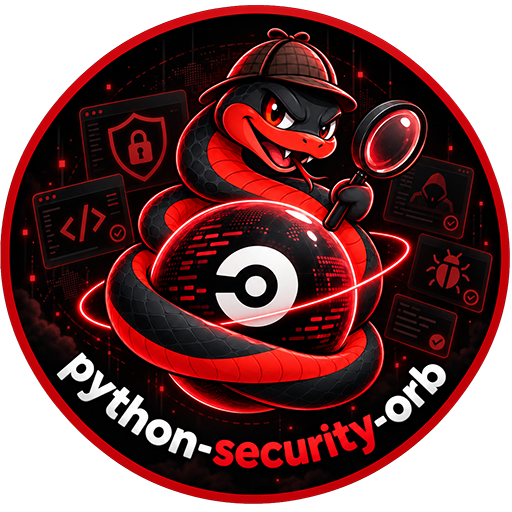
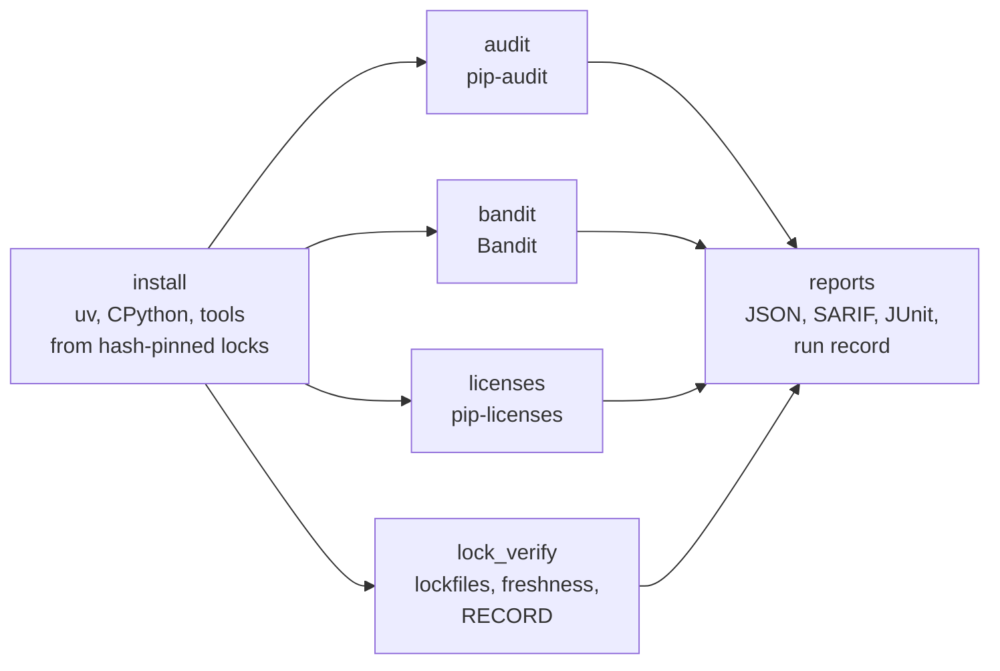

<div align="center">



# Python Security for CircleCI and GitHub Actions

### Audit dependencies, scan code, check licenses and verify lockfiles, with tools installed from hash-pinned locks.

Install [pip-audit](https://github.com/pypa/pip-audit), [Bandit](https://bandit.readthedocs.io/) and [pip-licenses](https://github.com/raimon49/pip-licenses) from locks that pin every file by SHA-256, on a CPython [uv](https://docs.astral.sh/uv/) verifies, and check a Python project's lockfiles, code and installed packages, as orb commands or GitHub Actions.<br>
Every lockfile format: uv, Poetry, PDM, Pipenv, pylock.toml, requirements · Nothing resolved, built or installed to audit<br>
Gates that tell findings from failures · SARIF, JUnit and run records · No `sudo`

[](https://circleci.com/gh/juburr/python-security-orb)
[](https://github.com/juburr/python-security-orb/actions/workflows/actions.yml)
[](https://circleci.com/developer/orbs/orb/juburr/python-security-orb)
[](LICENSE)
[](https://discuss.circleci.com/c/ecosystem/orbs)


**[Quick Start](#-quick-start)** · **[Features](#-why-python-security-orb)** · **[Recipes](#-recipes)** · **[Commands](#-commands)** · **[GitHub Actions](#-github-actions)** · **[Security](#-secure-by-design)** · **[Network Access](#-network-access)**

<sub>An unofficial, community-maintained CircleCI orb and set of GitHub Actions, not affiliated with the Python Software Foundation, PyPA or Astral. [Contributions are welcome!](#-contributing)</sub>

</div>

<br>

## ✨ Why python-security-orb?

<table>
<tr>
<td width="33%" valign="top">
📦 <b>Tools you can trust</b><br><br>
uv is checked against this orb's SHA-512 table, the CPython it installs against the SHA-256 uv carries for each build, and every wheel of every tool against this orb's lock for the release. Each tool lives in an environment of its own, run in isolated mode, so nothing in your project or job can reach it.
</td>
<td width="33%" valign="top">
🔍 <b>Every lockfile, nothing resolved</b><br><br>
<code>audit</code> reads uv.lock, poetry.lock, pdm.lock, Pipfile.lock, pylock.toml, pinned requirements and installed environments, and has pip-audit audit every locked version, whatever its markers, without resolving anything, building sdists or running <code>setup.py</code>.
</td>
<td width="33%" valign="top">
🛡️ <b>Bandit without blind spots</b><br><br>
A file Bandit can't parse, which it skips with exit code 0, fails the step, with the parser's message. <code>require_suppression_reasons</code> makes every <code># nosec</code> say why, and SARIF records each suppression in source.
</td>
</tr>
<tr>
<td width="33%" valign="top">
⚖️ <b>A license policy, not a string match</b><br><br>
<code>licenses</code> reads each package's License-Expression, License field and classifiers as SPDX expressions: an <code>OR</code> needs one allowed side, an <code>AND</code> every part. <code>clarify</code> settles what metadata leaves vague, and every package the environment holds must be in the inventory.
</td>
<td width="33%" valign="top">
🔒 <b>Lockfiles that pin what's installed</b><br><br>
<code>lock_verify</code> finds unpinned and unhashed packages, git sources without a commit, paths outside the checkout, plain-http indexes and too-new releases, asks uv, Poetry, PDM or Pipenv whether the lockfile still matches <code>pyproject.toml</code>, and checks installed files against RECORD.
</td>
<td width="33%" valign="top">
🚦 <b>Gates you can trust</b><br><br>
Findings fail the step unless <code>report_only</code> is true. A tool that crashed, which pip-audit and Bandit report with the same exit code as findings, or a check of nothing, fails it either way. Every command writes JSON, JUnit and an optional run record; all but <code>licenses</code> write SARIF.
</td>
</tr>
</table>

### 🧩 The Orb vs. a Hand-Rolled Script

| | Hand-rolled | python-security-orb |
|---|---|---|
| Installing the tools | `pip install pip-audit bandit`, whatever PyPI serves today, into the project's environment | every file pinned by SHA-256, in an environment of its own, on a verified CPython |
| Auditing a poetry.lock or uv.lock | export to requirements, or resolve the project again | read directly, every locked version audited |
| A tool that crashed | exit code 1, the same as findings | no verdict, whatever `report_only` says |
| Code Bandit can't parse | skipped silently | fails, naming the file and the parser's error |
| `# nosec` | silences anything | `require_suppression_reasons` makes each say why |
| License policy | `--allow-only` string matching | SPDX expressions, classifiers, `clarify`, `ignore` |
| A stale lockfile | installs something other than `pyproject.toml` asks for | caught by `lock_verify` |

## 🔄 How It Works



1. **`install`** puts uv on the `PATH`, installs a CPython with it, and installs each tool named in `tools` into its own environment from this orb's lock for the release.
2. **`audit`**, **`bandit`**, **`licenses`** and **`lock_verify`** each run their tool, write the reports, and fail the step on findings.

## 🚀 Quick Start

### CircleCI

```yaml
version: 2.1

orbs:
  python-security: juburr/python-security-orb@0.1.0

jobs:
  security:
    docker:
      - image: cimg/base:current
    steps:
      - checkout
      - python-security/install:
          tools: pip-audit,bandit
      - python-security/lock_verify
      - python-security/audit
      - python-security/bandit:
          targets: src

workflows:
  security:
    jobs:
      - security
```

`audit` and `lock_verify` check every lockfile in the working directory. The reports are in the job's artifacts under `python-security-reports/`, and the findings in its Tests tab.

### GitHub Actions

```yaml
jobs:
  python-security:
    runs-on: ubuntu-24.04
    permissions:
      contents: read
      security-events: write
    steps:
      - uses: actions/checkout@v7
      - uses: juburr/python-security-orb/actions/install@v0.1.0
        with:
          tools: pip-audit,bandit
      - uses: juburr/python-security-orb/actions/lock_verify@v0.1.0
      - uses: juburr/python-security-orb/actions/audit@v0.1.0
      - uses: juburr/python-security-orb/actions/bandit@v0.1.0
        with:
          targets: src
      - uses: github/codeql-action/upload-sarif@v4
        if: always()
        with:
          sarif_file: /tmp/python-security-reports
```

## 🍳 Recipes

### Adopt the Checks Gradually

`report_only: true` writes every report and leaves the step green, so you can see what a check finds before it gates anything. A check that couldn't complete still fails:

```yaml
- python-security/audit:
    report_only: true
- python-security/bandit:
    report_only: true
```

### Accept a Vulnerability

`ignore` takes vulnerability IDs, matched against each advisory's own ID and its aliases, so a CVE, GHSA or PYSEC ID works. An entry that no longer matches anything is a warning, or a failure with `unused_ignores: deny`, so ignores don't outlive the upgrade that fixed them:

```yaml
- python-security/audit:
    ignore: GHSA-j8r2-6x86-q33q PYSEC-2018-28
    unused_ignores: deny
```

A private package no public advisory database knows can't be audited, which fails the step: name it in `allow_skipped`. `service: osv` asks OSV instead of PyPI, and `osv_url` a self-hosted OSV API.

### Make Every `# nosec` Say Why

With `require_suppression_reasons`, Bandit runs a second time with `--ignore-nosec`, and every finding a `# nosec` suppressed must give a reason after a second `#`:

```python
subprocess.run(command, shell=True)  # nosec B602 # command is a constant
```

```yaml
- python-security/bandit:
    targets: src
    require_suppression_reasons: true
```

Bandit reads its settings from `pyproject.toml`'s `[tool.bandit]`, which the command passes it, or the file `config` names. A `.bandit` file is never read, since it can change the report's format.

### Check Licenses

`licenses` inventories an installed environment, `.venv` by default, so install the project's dependencies first:

```yaml
- python-security/install:
    tools: pip-licenses
- run: uv sync --locked --no-dev --python "${PYTHON_SECURITY_ORB_PYTHON}"
- python-security/licenses:
    allowed_licenses: Apache-2.0 BSD-2-Clause BSD-3-Clause ISC MIT MPL-2.0 PSF-2.0
    clarify: |
      idna==2.7=BSD-3-Clause
    ignore: our-internal-package
```

A package whose metadata names no license exactly, such as one with only the "BSD License" classifier, counts as not allowed: `clarify` gives its license, for a version or every version. The project itself isn't checked unless `check_project` is true.

### Keep Lockfiles Honest

```yaml
- python-security/lock_verify:
    min_release_age_days: 7
    allowed_indexes: https://pypi.org/simple
    environment: .venv
```

`min_release_age_days` reports releases uploaded more recently than that, since most malicious releases are found and removed within days; it reads the upload times uv.lock and pylock.toml record, and warns about lockfiles that record none (poetry.lock, pdm.lock, Pipfile.lock, requirements files). `allowed_indexes` limits the indexes a lockfile may name. `environment` checks every installed file against the SHA-256 its RECORD lists, and reports a `.pth` file no RECORD lists, since Python runs those at startup; nothing in the environment runs while it checks. `freshness: require` fails when a lockfile's package manager isn't on the `PATH` to check it.

### Install From a Private Index

For networks that can't reach PyPI, GitHub or Astral, point each download at a mirror. The locks still pin every file by SHA-256, so a mirror can only serve what PyPI published:

```yaml
- python-security/install:
    tools: pip-audit
    index_url: https://artifactory.example.com/api/pypi/pypi-remote/simple
    python_install_mirror: https://artifactory.example.com/artifactory/python-build-standalone
    download_base_url: https://artifactory.example.com/artifactory/github-releases
```

`python: system` runs the tools on the executor's own `python3` (3.10 to 3.14), so no CPython is downloaded at all.

### Upload SARIF to GitHub Code Scanning

On GitHub Actions, upload `output_dir` with `github/codeql-action/upload-sarif`, as the [Quick Start](#github-actions) does. Each report is `<report_name>.sarif`: give two runs of a command different `report_name`s.

### Keep a Run Record

`run_record: true` writes `<report_name>.run-record.json`: what was checked, from which inputs with their SHA-256, with which tool (its SHA-512 and install record), on which CI job, and what it found. Its schema is [`schemas/run-record.v1.json`](schemas/run-record.v1.json).

## 🧰 Commands

| Command | What it does |
|---|---|
| [`install`](#python-securityinstall) | Installs uv, then the Python and tools named in `tools` |
| [`install_uv`](#python-securityinstall_uv) | Installs uv, verified against this orb's checksum table |
| [`install_python`](#python-securityinstall_python) | Installs a CPython with uv, for `lock_verify` on an image without one |
| [`install_pip_audit`](#python-securityinstall_pip_audit) | Installs pip-audit from this orb's lock |
| [`install_bandit`](#python-securityinstall_bandit) | Installs Bandit from this orb's lock |
| [`install_pip_licenses`](#python-securityinstall_pip_licenses) | Installs pip-licenses from this orb's lock |
| [`audit`](#python-securityaudit) | Audits lockfiles, requirements or an environment for known vulnerabilities |
| [`bandit`](#python-securitybandit) | Scans code for security problems |
| [`licenses`](#python-securitylicenses) | Checks an environment's licenses against a policy |
| [`lock_verify`](#python-securitylock_verify) | Checks lockfiles pin and hash what gets installed, and are up to date |

Every parameter that names a value expands environment variables, except `output_dir`, which `store_artifacts` reads too. The checks share these parameters:

| Parameter | Default | Description |
|---|---|---|
| `working_dir` | `.` | The directory to run in; paths are relative to it |
| `output_dir` | `/tmp/python-security-reports` | Absolute path of the directory for the reports |
| `report_name` | the command's | The reports' file name without its extension |
| `junit` | `true` | Write JUnit to `output_dir/junit/<report_name>.xml` and store it |
| `run_record` | `false` | Also write `<report_name>.run-record.json` |
| `report_only` | `false` | Report findings without failing the step |
| `allow_empty` | `false` | Let a check of nothing pass |
| `store_artifacts` | `true` | Store `output_dir` under `python-security-reports/`, also when the step fails |

### `python-security/install`

| Parameter | Default | Description |
|---|---|---|
| `tools` | `pip-audit,bandit` | Any of `pip-audit`, `bandit`, `pip-licenses` and `python`, separated by commas or spaces |
| `pip_audit_version` | `2.10.1` | The pip-audit release |
| `bandit_version` | `1.9.4` | The Bandit release |
| `pip_licenses_version` | `5.5.5` | The pip-licenses release |
| `python` | `3.14` | `3.10` to `3.14` for a CPython uv downloads, `system`, or an interpreter's absolute path |
| `index_url` | `https://pypi.org/simple` | The package index to install the tools from |
| `python_install_mirror` | | A mirror of uv's Python downloads, `https://` or `file://` |
| `download_base_url` | | A mirror of GitHub Releases to download uv from |
| `uv_version` | `0.13.6` | The uv release |
| `caching` | `true` | Cache uv and the Python archive between jobs |
| `install_path` | `~/.python-security-orb/bin` | Where uv and the scripts that run the tools go, added to the `PATH` |
| `verify_checksums` | `strict` | `strict`, `known_versions` or `false` (see [Checksum Verification](#-checksum-verification)) |

Every tool install exports `PYTHON_SECURITY_ORB_PYTHON`, the Python the tools run on, which later steps can use too.

### `python-security/install_uv`

| Parameter | Default | Description |
|---|---|---|
| `version` | `0.13.6` | The uv release, from 0.13.0 |
| `verify_checksums` | `strict` | `strict`, `known_versions` or `false` |
| `install_path` | `~/.python-security-orb/bin` | Directory for `uv`, added to the `PATH` |
| `download_base_url` | | An https mirror of GitHub Releases, in place of `https://github.com` and `https://releases.astral.sh` |
| `caching` | `true` | Cache the verified release between jobs |

### `python-security/install_python`

`python`, `python_install_mirror`, `caching`, `install_path`, `verify_checksums`, `download_base_url` and `uv_version`, as for `install`, and `install_uv` (default `true`): install uv first, or use the one an earlier `install_uv` put in `install_path`.

### `python-security/install_pip_audit`

`version` (default `2.10.1`), and `index_url`, `python`, `python_install_mirror`, `caching`, `install_path`, `install_uv`, `uv_version`, `download_base_url` and `verify_checksums`, as for `install_python` and `install`.

### `python-security/install_bandit`

The same, with `version` defaulting to `1.9.4`. Bandit comes with its TOML extra, so it reads `pyproject.toml` on every Python.

### `python-security/install_pip_licenses`

The same, with `version` defaulting to `5.5.5`.

### `python-security/audit`

| Parameter | Default | Description |
|---|---|---|
| `lockfiles` | | Lockfiles, as paths or globs; with `requirements` and `environment` empty, every lockfile in `working_dir` |
| `requirements` | | Requirements files, each requirement pinned with `==`; `-r` includes are followed |
| `environment` | | An installed environment, as its interpreter or directory |
| `service` | `pypi` | `pypi`, or `osv` |
| `osv_url` | | A self-hosted OSV API, with `service: osv` |
| `timeout` | `15` | Seconds to wait for each request |
| `ignore` | | Vulnerability IDs or aliases to ignore |
| `unused_ignores` | `warn` | `allow`, `warn`, or `deny`, which fails on an ignore that matched nothing |
| `allow_skipped` | | Packages that may go unaudited, such as private ones |
| `extra_args` | | Further pip-audit arguments, such as `--cache-dir` |

Reports: `<report_name>.json` (the orb's summary, each finding with the inputs that lock it), `<report_name>.pip-audit.json` (pip-audit's own), `<report_name>.sarif` (each finding at the package's entry in each lockfile), JUnit (a case per package). `report_name` defaults to `pip-audit`.

### `python-security/bandit`

| Parameter | Default | Description |
|---|---|---|
| `targets` | `.` | Files and directories to scan, recursively |
| `exclude` | | Paths to leave out, added to Bandit's own and `.venv`, `venv`, `.nox` |
| `severity_level` | `low` | `low`, `medium` or `high`: the lowest severity reported |
| `confidence_level` | `low` | `low`, `medium` or `high`: the lowest confidence reported |
| `tests` | | Run only these tests, such as `B602,B608` |
| `skip` | | Tests to skip, such as `B101` |
| `config` | | A Bandit config; empty uses `pyproject.toml` when it has `[tool.bandit]` |
| `require_suppression_reasons` | `false` | Require a reason on every `# nosec` that suppressed a finding |
| `extra_args` | | Further Bandit arguments, such as `--number 5` |

Reports: `<report_name>.json` (Bandit's), `<report_name>.sarif` (with security severities and CWE tags, and suppressions in source), `<report_name>.suppressed.json` with `require_suppression_reasons`, JUnit. `report_name` defaults to `bandit`.

### `python-security/licenses`

| Parameter | Default | Description |
|---|---|---|
| `environment` | `.venv` | The environment to check, as its interpreter or directory |
| `allowed_licenses` | `Apache-2.0,BSD-2-Clause,BSD-3-Clause,ISC,MIT,PSF-2.0` | SPDX identifiers packages may have |
| `ignore` | | Packages not to check, as `name` or `name==version` |
| `clarify` | | `name[==version]=EXPRESSION` per line, for metadata that names no license exactly |
| `check_project` | `false` | Also check the project that `pyproject.toml` names |

Reports: `<report_name>.json` (each package with its license, where it was read from, and the verdict), `<report_name>.pip-licenses.json` (pip-licenses' own), `<report_name>.csv`, JUnit. `report_name` defaults to `licenses`.

### `python-security/lock_verify`

| Parameter | Default | Description |
|---|---|---|
| `lockfiles` | | Lockfiles, as paths or globs; with `requirements` and `environment` empty, every lockfile in `working_dir` |
| `requirements` | | Requirements files |
| `environment` | | An installed environment whose files to check against RECORD |
| `require_hashes` | `true` | Require a SHA-256 or stronger hash for every file |
| `min_release_age_days` | `0` | Report releases uploaded fewer days ago; `0` turns it off |
| `allowed_indexes` | | The only indexes a lockfile may use |
| `allow_local` | | Packages that may come from a path outside the lockfile's directory |
| `freshness` | `auto` | `auto`, `require` or `skip`: check each lockfile with its package manager |

Reports: `<report_name>.json`, `<report_name>.sarif` (each finding at its line), JUnit (a case per lockfile). `report_name` defaults to `lock-verify`. It reads TOML lockfiles with the Python `install` exported (`PYTHON_SECURITY_ORB_PYTHON`), or else `python3`, which must be 3.11 or newer, or have tomli: `install` with its default `python`, 3.14, provides one.

## ⚡ GitHub Actions

Every command has a composite action of the same name, with the same inputs and defaults, running the same scripts:

| Action | Command |
|---|---|
| `juburr/python-security-orb/actions/install@v0.1.0` | `install` |
| `juburr/python-security-orb/actions/install_uv@v0.1.0` | `install_uv` |
| `juburr/python-security-orb/actions/install_python@v0.1.0` | `install_python` |
| `juburr/python-security-orb/actions/install_pip_audit@v0.1.0` | `install_pip_audit` |
| `juburr/python-security-orb/actions/install_bandit@v0.1.0` | `install_bandit` |
| `juburr/python-security-orb/actions/install_pip_licenses@v0.1.0` | `install_pip_licenses` |
| `juburr/python-security-orb/actions/audit@v0.1.0` | `audit` |
| `juburr/python-security-orb/actions/bandit@v0.1.0` | `bandit` |
| `juburr/python-security-orb/actions/licenses@v0.1.0` | `licenses` |
| `juburr/python-security-orb/actions/lock_verify@v0.1.0` | `lock_verify` |

What one action exports, later steps see, as with CircleCI's `BASH_ENV`. A few differences:

- **Quote booleans and numbers** in `with:` (`report_only: "true"`), since every input is a string.
- **Environment variables aren't expanded in inputs.** Use `${{ env.NAME }}` instead.
- **The reports are uploaded as an artifact** named `python-security-reports-<report_name>-<random>`. JUnit stays in `output_dir/junit/` for a test reporter action.
- **The install actions cache with `actions/cache`**, keyed as on CircleCI.
- **Pin the actions to a commit SHA** for the strongest guarantee: `juburr/python-security-orb/actions/audit@<sha> # v0.1.0`.

## 🔒 Secure by Design

- **Verified downloads.** uv is checked against this orb's SHA-512 table before it runs. uv checks the CPython builds it downloads against the SHA-256 each uv release carries. Every wheel of every tool is checked against this orb's lock, with `--require-hashes`, so a package the lock doesn't pin fails the install.
- **No build code runs.** The tools install from wheels only, and `audit` and `lock_verify` read lockfiles without resolving, building or installing anything.
- **Isolated tools.** Each tool has its own environment and runs with `python -I`, so neither `PYTHONPATH`, the working directory's modules nor the project's dependencies reach it. Nothing a job or project configures for uv (`UV_*`, `uv.toml`, `[tool.uv]`) changes what is installed.
- **No settings from the code under test.** pip-licenses runs from an empty directory, so no `[tool.pip-licenses]` filters its inventory, and Bandit never reads a `.bandit` file, which could change its report's format.
- **Nothing executed from parameters.** `extra_args` is split like shell words, with nothing expanded or run, and options that would change what is checked or how the report is read are refused.
- **No `sudo`.** Everything installs and caches under `HOME`.

## 💻 Supported Platforms

- **Executors.** Linux on amd64 or arm64, glibc or musl, with bash 4, curl or wget, tar, gzip and jq: `cimg/base`, `cimg/python`, CircleCI's machine images, and GitHub's Ubuntu runners. No Python is needed: `install` brings one.
- **Python.** The tools run on CPython 3.10 to 3.14. `licenses` and `audit`'s `environment` list an environment with its own interpreter, which can be Python 3.8 or newer.
- **Lockfiles.** uv.lock (version 1), poetry.lock (1.x and 2.x), pdm.lock (4.x), Pipfile.lock (spec 6), pylock.toml (PEP 751), and pip requirements files.
- **CI.** CircleCI tests every command with the real tools, and the installs on amd64 and arm64 and with the oldest Python the locks cover; GitHub Actions tests every action the same way.

## 🔐 Checksum Verification

**uv.** `src/install/uv/install.sh` holds the SHA-512 of the `uv` binary in the static musl release archives of every uv release from **0.13.0 to 0.13.6**. `src/install/uv/install_hash.sh -v <version>` prints new entries after checking each archive against the release's `.sha256`, and against its GitHub build provenance attestation when `gh` is installed.

**The tools.** `src/install/<tool>/locks.txt` holds a lock for each release this orb installs: **pip-audit 2.10.0 and 2.10.1, Bandit 1.9.3 and 1.9.4, pip-licenses 5.5.4 and 5.5.5**, with every dependency pinned and every wheel by SHA-256, for CPython 3.10 to 3.14 on x86_64 and aarch64, glibc and musl. `src/install/lock.sh -t <tool> -v <version>` writes a new one: it resolves with uv from wheels uploaded at least 7 days earlier, so a compromised release has time to come to light, and checks the tool's own wheel against its PyPI attestation when `pypi-attestations` is installed.

| Mode | Listed version | Unlisted version |
|---|---|---|
| `strict` (default) | verified | fails before downloading anything |
| `known_versions` | verified | installed **unverified**, with a warning |
| `false` | not verified | not verified |

The install record beside each tool's script (`.<tool>.install.json`) says which, and the run records include it.

## 🌐 Network Access

| Host | When |
|---|---|
| `github.com` (and its release asset hosts), then `releases.astral.sh` | installing uv, unless `download_base_url` names a mirror or the release comes from the cache |
| The python-build-standalone release host uv uses | installing a CPython, unless `python_install_mirror` names a mirror, the archive comes from the cache, or `python` is `system` or a path |
| `pypi.org` and `files.pythonhosted.org` | installing the tools, unless `index_url` names a mirror |
| `pypi.org` | `audit` with `service: pypi` |
| `api.osv.dev` | `audit` with `service: osv`, unless `osv_url` names your own |
| The project's package indexes | `lock_verify`, when uv, Poetry, PDM or Pipenv needs them to check a lockfile |

`bandit` and `licenses` make no network requests.

## 🗺️ Not Yet Included

- **OSV-Scanner** and other multi-ecosystem scanners: they belong in an orb of their own.
- **Safety**, which needs an account, **GuardDog**'s malicious-package heuristics, and `uv audit`, still in preview.
- **Verifying dependencies' PEP 740 attestations**: few packages publish them yet.
- **Semgrep** and other general static analysis.
- **macOS and Windows executors.**

## 🤝 Contributing

```bash
# Lint
yamllint .
shellcheck src/scripts/*.sh src/scripts/lib/*.sh src/install/*.sh src/install/*/*.sh actions/*.sh tests/*.sh

# Offline tests (jq, python3 3.11 or newer, and jsonschema for the run record schema)
for t in tests/*_test.sh; do bash "$t" || break; done

# Pack and validate
circleci orb pack src/ > orb.yml && circleci orb validate orb.yml

# Table entries for a new uv release, and a lock for a new tool release
./src/install/uv/install_hash.sh -v <version>
./src/install/lock.sh -t <tool> -v <version>
```

Pull requests run the offline tests, then every command with the real tools on CircleCI (`.circleci/test-deploy.yml`) and every action on GitHub's runners (`.github/workflows/actions.yml`).

## 🎨 Logo

The logo is in [`assets/logos`](assets/logos), from 64 to 1024 pixels.

## 📜 License

[MIT](LICENSE). "Python" is a registered trademark of the Python Software Foundation; this project is not affiliated with the Python Software Foundation, PyPA or Astral.
